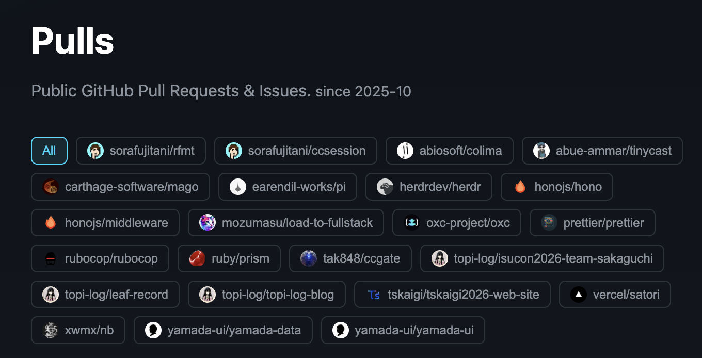

<CoverSlide
  title="2026年 OSS contribution まとめ"
  subtitle="TechBull mini LT&交流会 #5"
  author="fujitani sora"
/>

<!--
目安 20秒

今年作ったものと、ほかのOSSで取り組んだことを紹介します。
数字は2026年11月24日時点です。
-->

---

<ProfileSlide
  name="fujitani sora"
  x="sorafujitani"
  github="sorafujitani"
  website="https://sorafujitani.me/"
  avatar="https://raw.githubusercontent.com/fs0414/imgs/main/fs0414_dot_image.png"
  :items="[
    { icon: 'calendar', label: '2001 (25)' },
  ]"
/>

---

# rfmt

Rustの高速なRuby Code Formatter

- https://github.com/sorafujitani/rfmt
- RubyGemsで累計37,629ダウンロード
- [Short Ruby Newsletter #165](https://newsletter.shortruby.com/p/edition-165) で紹介
- [2.0.0.beta1](https://github.com/sorafujitani/rfmt/releases/tag/v2.0.0.beta1) を最新で公開

<!--
目安 1分

Rubyのコードを一定のスタイルに整えるツールです。
今年は2.0のベータ版を公開しました。1月にはShort Ruby Newsletterの新着gem欄で紹介され、RubyGemsの累計ダウンロードは約3.8万件になりました。

https://rubygems.org/api/v1/gems/rfmt.json
https://newsletter.shortruby.com/p/edition-165
-->

---

# ccsession

AIエージェントの過去の会話を探して再開するCLI

- https://github.com/sorafujitani/ccsession
- GitHub Releasesで配布バイナリが累計8,443ダウンロード
- Articles
  - [Claude Codeのセッション履歴をfzf検索 & previewする技術（ccsession）](https://zenn.dev/soramarjr/articles/4eb891ab20498e)
  - [CLI派歓喜！Claude Code履歴検索のccsessionが便利](https://eiji.page/blog/ccsession-intro/)

<!--
目安 1分10秒

前にどのプロジェクトで話したか忘れても、会話を横断して検索し、選んだセッションを元の作業場所から再開できます。
5月に公開しました。Claude Code向けに作り始めて、CodexやOpenCodeなどでも使えるようにしました。

https://github.com/sorafujitani/ccsession
https://eiji.page/blog/ccsession-intro/
https://api.github.com/repos/sorafujitani/ccsession/releases?per_page=100
-->

---

# 自作OSSの傾向

- 2026年に32件のOSSリポジトリを作成
- 主言語の内訳（リポジトリ数ベース）
  - Rust 40.6%、TypeScript 25%、Go 18.8%、その他 15.6%
- 公開リポジトリ全体でマージ済みPR 164件、コミット1,385件

<!--
目安 30秒

ほかにも普段の開発で使うツールを作りました。たとえばpanopticonは、エージェントが実行したツールや、エラーが起きた箇所を振り返るためのものです。
2026年11月24日までに作成した本人の公開・非forkリポジトリのうち、ccsessionを除くMIT・Apache-2.0の32件を対象にしています。
GitHubで主言語の判定がない8件をRustに加え、Rust 13件、TypeScript 8件、Go 6件としています。その他はHTML、JavaScript、MoonBit、Python、Swiftが各1件です。
活動件数は、ライセンスの有無を問わず、本人所有の公開・非forkの161リポジトリについて、2026年1月1日から11月24日まで（日本時間）を集計しています。PRは期間内のマージを数え、コミットは各リポジトリのデフォルトブランチの履歴を合算しました。

https://api.github.com/users/sorafujitani/repos?per_page=100&sort=created&direction=desc&page=1
-->

---

# Contributions to Other OSS

- **Oxc**　OxlintにNode.js向けのルールを実装したり
- **Hono**　言語判定で ja-JP から ja を選べるようにしたりテストを最新化したり
- **Ruby**　Ruby PrismのBuildとRuboCopの自動修正を改善したり
- その他もろもろ

[PR・Issue一覧](https://sorafujitani.me/pulls/)

<!--
目安 2分

OxcではOxlintにNode.js向けのルールを追加しました。Honoでは、たとえば日本向けの言語コードを受け取ったときに、日本語の設定を使えるようにしました。
Ruby Prismはrfmtでも使っているライブラリです。rfmtを別の環境向けにビルドする際に見つけた問題を報告し、修正PRを出しました。

Oxc
https://github.com/oxc-project/oxc/pull/23539
https://github.com/oxc-project/oxc/pull/23589

Hono
https://github.com/honojs/hono/pull/4717

Ruby
https://github.com/ruby/prism/pull/4179
https://github.com/rubocop/rubocop/pull/15101

PR・Issue一覧
https://sorafujitani.me/pulls/
-->

---

